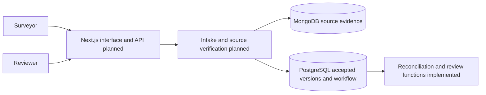

# FieldMerge

Solo DBMS project for conflict-safe reconciliation of delayed urban tree survey updates.

Field surveyors may submit proposals based on old record snapshots. FieldMerge combines compatible changes, holds competing values for reviewer decisions, and preserves the origin of accepted values. The application context is a tree survey; the current implementation is the tested database layer, with the Next.js interface and authenticated intake still in development.

**Stack:** PostgreSQL, MongoDB, Docker Compose, and a planned Next.js application.

**Verified database milestone:** 136 assertions and six concurrent-session scenarios, plus agreement of published form hashes across both databases. These results are database-level evidence, not a claim that the complete application is finished.

The [complete project checklist](docs/FieldMerge_Project_Checklist.md) tracks completed and remaining work from problem selection through final submission.



## Current milestone

The development databases, automatic SQL reconciliation, and reviewer decisions are implemented and verified. PostgreSQL has nine business tables, four read views, scalar validation, history protection, an initial-version constraint trigger, and a restricted application group. Migration 002 adds automatic reconciliation and provenance; migration 003 adds reviewer decisions with immutable receipts and concurrency/retry protection. MongoDB has three collections, strict validators, indexes, and service roles restricting source-evidence mutation.

Automatic reconciliation publishes compatible fields and holds conflicts. Reviewers can accept a proposal, keep current, or replace a value with version/revision checks and exact retry receipts. Complete state/provenance consistency enforcement outside these functions, authenticated APIs, row access policies, MongoDB verification handoff, draft-finalization coordination, cross-store recovery tests, and the Next.js interface remain. The complete set of 35 end-to-end acceptance scenarios is not claimed to pass. See [automatic reconciliation](docs/FieldMerge_Reconciliation.md) and [reviewer decisions](docs/FieldMerge_Reviewer_Decisions.md) for tested boundaries.

## Prerequisites

- Windows PowerShell or PowerShell 7 and Node.js.
- Running Docker Desktop using Linux containers and Docker Compose.
- Initial internet access to download the official database images. The exact tested image digests are in .env.example.

The script locates Docker on PATH or at its standard per-user Docker Desktop location. It also adds that directory to its own process PATH so the credential helper can be found after a recent Docker installation. It does not change your Windows PATH permanently.

## Set up and verify

From the project folder in PowerShell:

```powershell
.\scripts\database.ps1 Setup
```

Setup generates an ignored .env only if absent, with random database credentials. It generates consistent synthetic fixtures, starts local development containers, runs checks against separate test services/databases, then applies the verified migration and seed to development. Re-running Setup checks the migration checksum and preserves existing seeded records rather than resetting the database.

If the local PowerShell execution policy blocks this file, run it in a new process without changing the machine policy:

```powershell
powershell.exe -NoProfile -ExecutionPolicy Bypass -File .\scripts\database.ps1 Setup
```

Other actions:

```powershell
.\scripts\database.ps1 Status
.\scripts\database.ps1 Verify
.\scripts\database.ps1 Stop
.\scripts\database.ps1 Start
```

Start only starts the services/prepares fixtures; use Setup to apply schemas. Stop preserves development volumes. There is deliberately no automatic development reset/delete action. Do not remove volumes merely to rerun tests.

## Local connection details

| Database | Host and port | Database | Admin username |
|---|---|---|---|
| PostgreSQL | 127.0.0.1:15432 | fieldmerge | fieldmerge_owner |
| MongoDB | 127.0.0.1:27018 | fieldmerge; authenticate against admin | fieldmerge_root |

Passwords are in the ignored .env. Do not commit it, paste it into reports, or use admin credentials in a browser. These are development administration accounts; separate API login/service accounts will be provisioned with the workflow migration. fieldmerge_app is currently a NOLOGIN group with no direct table access, intentionally unusable for unfinished API operations.

Docker binds database ports only to loopback. Development data is in named volumes fieldmerge_pg_data and fieldmerge_mongo_data. Test services publish no ports and use tmpfs storage, with independent PostgreSQL and MongoDB instances. Verify creates a unique test database and retains it for inspection until those test containers are removed/recreated. It never runs test mutations on development databases.

## Seeds and credentials

The seed is explicitly synthetic, not an imported NYC census subset. It contains one campaign, three trees at version 1, two form definitions, and surveyor/reviewer accounts. Form-definition hashes agree across both stores.

Demo account passwords and scrypt hashes are generated in ignored tmp/database-fixtures/demo-accounts.json. Do not expose that file in a submission. It is not yet connected to a login screen. Keep this fixture directory when re-running Setup against existing development volumes: regenerating the account file does not reset existing seeded account hashes. Account rotation will require an explicit operation later.

## Verification evidence

The last successful run is recorded in [output/database/verification.json](output/database/verification.json). A failed run exits nonzero and does not claim success. An existing report from an earlier run remains historical evidence; inspect its timestamp.

The structural suite covers:

- Composite keys, foreign keys, same-tree references, and initial version existence.
- Duplicate request/change/decision constraints.
- Typed null/false/zero handling, precision validation, and invalid source documents.
- Immutable SQL history and source-evidence service-role restrictions.
- Draft revision matching and permitted document CRUD mechanics.
- Form registry hash agreement and repeatable seeds across both databases.

The suite also exercises automatic reconciliation and reviewer decisions with trusted SQL fixtures, injected rollback failures, and six real concurrent-session scenarios. These are not end-to-end API or MongoDB intake tests. Fixtures use admin access to simulate the future verified-input handoff; the ordinary application role cannot call the workflow yet.

## Repository map

- docs/FieldMerge_Requirements.md — authoritative requirements and acceptance scenarios.
- docs/FieldMerge_Relational_Schema.md — SQL mapping and outstanding workflow enforcement.
- docs/FieldMerge_MongoDB_Model.md — collection model and application boundary.
- database/postgres/migrations/001_structure.sql — transactional initial schema.
- database/mongodb/ — strict model, initialization, and form seeds.
- database/scripts/generate-fixtures.mjs — local secret and fixture generation; no dependencies required.
- scripts/database.ps1 — repeatable environment/schema/verification commands.
- tests/database/ — real-database structural checks.

Applied migrations are checksum-protected. Further schema changes must use a new migration instead of silently modifying an already applied file. The runner discovers ordered NNN_name.sql migrations and verifies each applied checksum; migrations 001, 002, and 003 are currently implemented.
