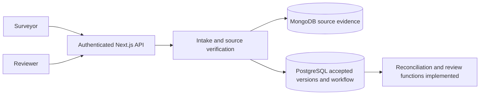

# FieldMerge

Solo DBMS project for conflict-safe reconciliation of delayed urban tree survey updates.

Repository: [looney2000s/fieldmerge](https://github.com/looney2000s/fieldmerge).

Surveyors submit changes based on accepted record versions. FieldMerge combines compatible updates, holds competing values, and records reviewer decisions and value provenance. The authenticated API is implemented; the full surveyor/reviewer interface is the next major milestone.

**Stack:** Next.js, PostgreSQL, MongoDB, and Docker Compose.

**Verified database milestone:** 209 assertions, four actual COMMIT scenarios, and six concurrent-session scenarios, plus agreement of published form hashes across both databases. These results are database-level evidence, not a claim that the complete application is finished.

**Verified API milestone:** six canonicalization/validation test groups, twenty-four API/worker integration groups against a production Next.js server and real isolated databases, and a successful production build. Coverage includes authentication, source verification, draft finalization, review, commit-time rollback, automatic recovery, quarantine, leases, and worker-process restart.

The [complete project checklist](docs/FieldMerge_Project_Checklist.md) tracks completed and remaining work from problem selection through final submission.



## Current milestone

The development databases, automatic SQL reconciliation, reviewer decisions, and authenticated Next.js API are implemented. PostgreSQL has nine business tables, four read views, history protection, and guarded API functions. Migrations 001–003 implement database workflows; migration 004 adds internal session/rate-limit tables and session-aware access functions; migration 005 validates draft targets; migration 006 protects commit-time consistency; migration 007 adds persistent recovery jobs/events and restricted worker entry points. MongoDB has three validated collections and separate restricted API/worker credentials.

Login, verified intake, owner-scoped drafts/finalization, batches, reviewer decisions, history, source retrieval, and [commit-time integrity](docs/FieldMerge_Workflow_Integrity.md) are implemented. The [automatic recovery worker and reviewer operations API](docs/FieldMerge_Recovery.md) now resume incomplete intake/sealed drafts with durable leases, bounded retry, quarantine, and event history. Remaining work includes richer query/export APIs, performance/query evidence, complete acceptance coverage, and the full interface. The 35 acceptance scenarios are not yet all closed. See [drafts](docs/FieldMerge_Drafts.md), [the API guide](docs/FieldMerge_API.md), [reconciliation](docs/FieldMerge_Reconciliation.md), and [reviewer decisions](docs/FieldMerge_Reviewer_Decisions.md).

## Prerequisites

- Windows PowerShell or PowerShell 7, Node.js 22 or later, and pnpm 11.
- Running Docker Desktop using Linux containers and Docker Compose.
- Initial internet access to download the official database images. The exact tested image digests are in .env.example.

The script locates Docker on PATH or at its standard per-user Docker Desktop location. It also adds that directory to its own process PATH so the credential helper can be found after a recent Docker installation. It does not change your Windows PATH permanently.

## Set up and verify

From the project folder in PowerShell:

```powershell
.\scripts\database.ps1 Setup
```

Then install the API dependencies and configure its restricted connections:

```powershell
pnpm install --frozen-lockfile
pnpm configure:backend
pnpm dev
```

For continuous automatic recovery, run pnpm worker in a separate terminal. pnpm worker:once runs one bounded cycle. The [recovery guide](docs/FieldMerge_Recovery.md) explains statuses, safe retries, and reviewer inspection. The worker must be running for unattended recovery; it is not installed as a Windows service.

Open http://localhost:3000. The home page is currently a backend-status placeholder, not the final workflow interface. The API guide provides PowerShell examples. If Windows memory pressure interrupts dependency install scripts, `pnpm install --frozen-lockfile --ignore-scripts --child-concurrency=1` is the installation mode verified for this milestone; the production build was checked afterward.

Verification commands:

```powershell
pnpm test:unit
pnpm build
pnpm test:api
```

test:api starts a temporary production server on 127.0.0.1:3100 against unique isolated databases on the existing development database services. Those services must be running, and Setup must have generated the fixtures. It leaves development records untouched and stops the temporary API server afterward. It uses administrative credentials only to provision test databases, while actual HTTP requests use restricted API accounts. The latest successful API evidence is in [output/api/verification.json](output/api/verification.json).

Setup generates an ignored .env only if absent, with random database credentials. It generates consistent synthetic fixtures, starts local development containers, runs checks against separate test services/databases, then applies the verified migration and seed to development. Re-running Setup checks the migration checksum and preserves existing seeded records rather than resetting the database.

If the local PowerShell execution policy blocks this file, run it in a new process without changing the machine policy:

```powershell
powershell.exe -NoProfile -ExecutionPolicy Bypass -File .\scripts\database.ps1 Setup
```

Other actions:

```powershell
.\scripts\database.ps1 Status
.\scripts\database.ps1 Verify
.\scripts\database.ps1 Stop
.\scripts\database.ps1 Start
```

Start only starts the services/prepares fixtures; use Setup to apply schemas. Stop preserves development volumes. There is deliberately no automatic development reset/delete action. Do not remove volumes merely to rerun tests.

## Local connection details

| Database | Host and port | Database | Admin username |
|---|---|---|---|
| PostgreSQL | 127.0.0.1:15432 | fieldmerge | fieldmerge_owner |
| MongoDB | 127.0.0.1:27018 | fieldmerge; authenticate against admin | fieldmerge_root |

Passwords are in the ignored .env. Do not commit it, paste it into reports, or use admin credentials in a browser. configure:backend provisions separate fieldmerge_api logins and generated DATABASE_URL/MONGODB_URI settings. The backend refuses owner/root connection identities. The legacy fieldmerge_app group remains unused with no direct table access. Browser requests receive only an opaque HttpOnly session cookie.

Docker binds database ports only to loopback. Development data is in named volumes fieldmerge_pg_data and fieldmerge_mongo_data. Test services publish no ports and use tmpfs storage, with independent PostgreSQL and MongoDB instances. Verify creates a unique test database and retains it for inspection until those test containers are removed/recreated. It never runs test mutations on development databases.

## Seeds and credentials

The seed is explicitly synthetic, not an imported NYC census subset. It contains one campaign, three trees at version 1, two form definitions, and surveyor/reviewer accounts. Form-definition hashes agree across both stores.

Demo account passwords and scrypt hashes are generated in ignored tmp/database-fixtures/demo-accounts.json. Do not expose that file in a submission. These accounts now work through the login API; a login screen remains to be built. Keep this fixture directory when re-running Setup against existing development volumes: regenerating the account file does not reset existing seeded account hashes. Account rotation will require an explicit operation later.

## Verification evidence

The last successful run is recorded in [output/database/verification.json](output/database/verification.json). A failed run exits nonzero and does not claim success. An existing report from an earlier run remains historical evidence; inspect its timestamp.

The structural suite covers:

- Composite keys, foreign keys, same-tree references, and initial version existence.
- Duplicate request/change/decision constraints.
- Typed null/false/zero handling, precision validation, and invalid source documents.
- Immutable SQL history and source-evidence service-role restrictions.
- Draft revision matching and permitted document CRUD mechanics.
- Form registry hash agreement and repeatable seeds across both databases.

The database suite exercises automatic reconciliation and reviewer decisions with trusted SQL fixtures, injected rollback failures, and six real concurrent-session scenarios. Separate API tests exercise actual HTTP sessions and cross-store intake using restricted credentials. The raw workflow functions remain inaccessible to application logins; session-aware SQL wrappers are the permitted entry points.

## Repository map

- docs/FieldMerge_Requirements.md — authoritative requirements and acceptance scenarios.
- docs/FieldMerge_Relational_Schema.md — SQL mapping and outstanding workflow enforcement.
- docs/FieldMerge_MongoDB_Model.md — collection model and application boundary.
- database/postgres/migrations/001_structure.sql — transactional initial schema.
- database/mongodb/ — strict model, initialization, and form seeds.
- database/scripts/generate-fixtures.mjs — local secret and fixture generation; no dependencies required.
- scripts/database.ps1 — repeatable environment/schema/verification commands.
- tests/database/ — real-database structural checks.

Applied migrations are checksum-protected. Further schema changes must use a new migration instead of silently modifying an already applied file. The runner discovers ordered NNN_name.sql migrations and verifies each applied checksum; migrations 001 through 007 are currently implemented.
