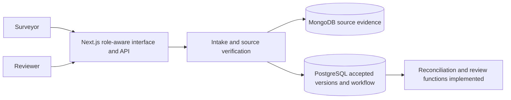

# FieldMerge

Solo DBMS project for conflict-safe reconciliation of delayed urban tree survey updates.

Repository: [looney2000s/fieldmerge](https://github.com/looney2000s/fieldmerge).

**Project report:** [Read the final PDF](output/pdf/FieldMerge_Project_Report.pdf). The 34-page report includes the author-supplied Chen ER diagram on page 9, database design, implementation, queries, screenshots, testing, the full data dictionary and foreign-key relationships.

Surveyors submit changes based on accepted record versions. FieldMerge combines compatible updates, holds competing values, and records reviewer decisions and value provenance. The authenticated Next.js interface now supports the surveyor and reviewer workflows. See the [interface guide](docs/FieldMerge_Interface.md) for startup, usage, retries, and verification.

**Stack:** Next.js, PostgreSQL, MongoDB, and Docker Compose.

**Verified database milestone:** 231 assertions, four actual COMMIT scenarios, and six concurrent-session scenarios, plus agreement of published form hashes across both databases. These results are database-level evidence, not a claim that the complete application is finished.

**Verified API milestone:** eighteen validation/export/logging unit groups, thirty-three API/worker/query integration groups against a production Next.js server and real isolated databases, and a successful production build. Coverage includes authentication, reconciliation/review, drafts, recovery, filtered queries, summaries, snapshots, CSV/JSON exports, durable batch replay, and interface read models.

**Verified acceptance milestone:** all 35 requirements-baseline scenarios pass against real PostgreSQL/MongoDB services and a production Next.js API, including lock-controlled races, service unavailability, rollback/retry, both forms, re-import, and provenance. [Results and limits](docs/FieldMerge_Acceptance.md).

**Design and report:** the [complete physical dictionary](docs/FieldMerge_Data_Dictionary.md) reconciles 17 tables, 146 columns and 29 foreign keys against the live catalog. Read the [architecture](docs/FieldMerge_Architecture.md), [implementation report](output/pdf/FieldMerge_Project_Report.pdf), [demonstration guide](docs/FieldMerge_Demonstration.md) and [rubric evidence map](docs/FieldMerge_Rubric_Evidence.md). The report includes the author-supplied Chen diagram.

**Clean checkout verification:** published commit 62236a2 passed a fresh frozen install, production build, all database/API/acceptance/security/browser/query suites, and catalog reconciliation against newly generated isolated databases. All 17 stages and cleanup passed. See [release results](output/release/README.md) and [the reproduction guide](docs/FieldMerge_Release_Verification.md). The verified implementation is integrated into main; see the [integration record](docs/FieldMerge_Main_Integration.md). The author's demonstration and final submission remain.

The [complete project checklist](docs/FieldMerge_Project_Checklist.md) tracks completed and remaining work from problem selection through final submission.

**Verified interface milestone:** fifteen browser workflow checks and nine representative axe WCAG A/AA page checks, with no reported violations or browser runtime errors. Coverage includes both roles, actual SQL/MongoDB outcomes, stale review handling, lost-response retries, exports, keyboard access, and a 390px mobile layout. See [browser results](output/browser/checks.json).

**Query/performance evidence:** twelve SQL demonstrations, four MongoDB query patterns, guarded workflow/draft and disposable DDL/DML demonstrations, and measured plans on 10,003 synthetic accepted records, 14,308 snapshots and 4,504 sealed source documents. Twenty-one evidence checks pass. Read the [measurement report](output/performance/README.md) and [query/viva guide](docs/FieldMerge_Query_Demonstrations.md). These are warmed local database-call measurements, not website capacity or production response-time claims.



## Current milestone

The development databases, SQL reconciliation, reviewer decisions, authenticated API, and Next.js interface are implemented. PostgreSQL has nine business tables, four read views, and guarded workflow/read functions. Migrations 001–007 implement core structures, sessions, drafts, integrity, and recovery; migration 008 adds filtered reads, reports/exports, and two internal transport-batch tables. Migration 009 adds guarded interface read models without adding tables. Migration 010 adds persistent safe failure events and guarded reviewer inspection. There are 17 SQL tables: nine business, two authentication, five operational/transport, and one migration registry. MongoDB has three validated collections and separate restricted API/worker credentials.

Login, accepted-record browsing, drafts/finalization, batch upload, per-field outcomes, reviewer comparisons/decisions, history/provenance, reports/exports, and recovery inspection are available in the interface. [Commit-time integrity](docs/FieldMerge_Workflow_Integrity.md) and [automatic recovery](docs/FieldMerge_Recovery.md) remain enforced by the backend. All 35 functional acceptance scenarios now pass with an explicit [evidence map](docs/FieldMerge_Acceptance.md). Query demonstrations and local measurement evidence are also prepared. Targeted transport/security coverage and independent persistent failure logging now pass 23 API groups and five additional browser checks; see the [security guide](docs/FieldMerge_Security.md). The reconciled dictionary, architecture, implementation report and clean published-checkout verification are complete. The verified implementation is integrated into main. Remaining work includes the author's demonstration rehearsal and final submission deliverables. See [drafts](docs/FieldMerge_Drafts.md), [the API guide](docs/FieldMerge_API.md), [query/export/batch behavior](docs/FieldMerge_Queries_Exports_Batches.md), and [reviewer decisions](docs/FieldMerge_Reviewer_Decisions.md).

## Prerequisites

- Windows PowerShell or PowerShell 7, Node.js 22 or later, and pnpm 11.
- Running Docker Desktop using Linux containers and Docker Compose.
- Initial internet access to download the official database images. The exact tested image digests are in .env.example.

The script locates Docker on PATH or at its standard per-user Docker Desktop location. It also adds that directory to its own process PATH so the credential helper can be found after a recent Docker installation. It does not change your Windows PATH permanently.

## Set up and verify

From the project folder in PowerShell:

```powershell
.\scripts\database.ps1 Setup
```

Then install the application dependencies and configure its restricted connections:

```powershell
pnpm install --frozen-lockfile
pnpm configure:backend
pnpm dev
```

For continuous automatic recovery, run pnpm worker in a separate terminal. pnpm worker:once runs one bounded cycle. The [recovery guide](docs/FieldMerge_Recovery.md) explains statuses, safe retries, and reviewer inspection. The worker must be running for unattended recovery; it is not installed as a Windows service.

Open http://localhost:3000, matching APP_ORIGIN in .env. The home page opens the workspace and redirects unauthenticated visitors to sign in. Generated surveyor/reviewer account credentials are in the ignored `tmp/database-fixtures/demo-accounts.json`; open it privately. The [interface guide](docs/FieldMerge_Interface.md) explains a complete demonstration. The API guide also provides PowerShell examples. If Windows memory pressure interrupts dependency install scripts, `pnpm install --frozen-lockfile --ignore-scripts --child-concurrency=1` is the installation mode verified for this milestone; the production build was checked afterward.

Verification commands:

```powershell
pnpm test:unit
pnpm build
pnpm test:api
pnpm test:acceptance
pnpm test:security
# One-time browser download, into the ignored workspace directory:
$env:PLAYWRIGHT_BROWSERS_PATH = Join-Path (Get-Location) 'tmp\playwright-browsers'
pnpm exec playwright install chromium
pnpm test:browser
```

test:api, test:security and test:browser each start a temporary production server on 127.0.0.1:3100 against unique isolated databases on the existing development database services. Run them sequentially after building. Those services must be running, and Setup must have generated the fixtures. They leave development records untouched and stop their temporary server afterward. They use administrative credentials only to provision test databases, while actual HTTP requests use restricted API accounts. Evidence is in [output/api/verification.json](output/api/verification.json) and [output/browser/verification.json](output/browser/verification.json); workflow/accessibility details and screenshots accompany the browser report. These remain representative browser/API checks. The separate pnpm test:acceptance suite closes AC01–AC35 on disposable services, including an actual MongoDB service-unavailability check; see the [acceptance guide](docs/FieldMerge_Acceptance.md).

Run the independent database demonstration/measurement suite with Docker Desktop running:

```powershell
pnpm db:evidence
pnpm db:evidence:summary
```

It creates a separate temporary Compose project, generates real synthetic workflow history through guarded functions, measures warmed reads and index alternatives, then removes that project's services. It does not need a Next.js server/build or modify development data. The summary command formats the saved JSON as Markdown and CSV. Use `pnpm run db:evidence --keep` only when you want to retain the temporary databases for inspection; the [query guide](docs/FieldMerge_Query_Demonstrations.md) explains access and cleanup.

Setup generates an ignored .env only if absent, with random database credentials. It generates consistent synthetic fixtures, starts local development containers, runs checks against separate test services/databases, then applies the verified migration and seed to development. Re-running Setup checks the migration checksum and preserves existing seeded records rather than resetting the database.

If the local PowerShell execution policy blocks this file, run it in a new process without changing the machine policy:

```powershell
powershell.exe -NoProfile -ExecutionPolicy Bypass -File .\scripts\database.ps1 Setup
```

Other actions:

```powershell
.\scripts\database.ps1 Status
.\scripts\database.ps1 Verify
.\scripts\database.ps1 Stop
.\scripts\database.ps1 Start
```

Start only starts the services/prepares fixtures; use Setup to apply schemas. Stop preserves development volumes. There is deliberately no automatic development reset/delete action. Do not remove volumes merely to rerun tests.

## Local connection details

| Database | Host and port | Database | Admin username |
|---|---|---|---|
| PostgreSQL | 127.0.0.1:15432 | fieldmerge | fieldmerge_owner |
| MongoDB | 127.0.0.1:27018 | fieldmerge; authenticate against admin | fieldmerge_root |

Passwords are in the ignored .env. Do not commit it, paste it into reports, or use admin credentials in a browser. configure:backend provisions separate fieldmerge_api logins and generated DATABASE_URL/MONGODB_URI settings. The backend refuses owner/root connection identities. The legacy fieldmerge_app group remains unused with no direct table access. Browser requests receive only an opaque HttpOnly session cookie.

Docker binds database ports only to loopback. Development data is in named volumes fieldmerge_pg_data and fieldmerge_mongo_data. Test services publish no ports and use tmpfs storage, with independent PostgreSQL and MongoDB instances. Verify creates a unique test database and retains it for inspection until those test containers are removed/recreated. It never runs test mutations on development databases.

## Seeds and credentials

The seed is explicitly synthetic, not an imported NYC census subset. It contains one campaign, three trees at version 1, two form definitions, and surveyor/reviewer accounts. Form-definition hashes agree across both stores.

Demo account passwords and scrypt hashes are generated in ignored tmp/database-fixtures/demo-accounts.json. Do not expose that file in a submission. These accounts work through the login API and the implemented sign-in screen. Keep this fixture directory when re-running Setup against existing development volumes: regenerating the account file does not reset existing seeded account hashes. Account rotation will require an explicit operation later.

## Verification evidence

The last successful run is recorded in [output/database/verification.json](output/database/verification.json). A failed run exits nonzero and does not claim success. An existing report from an earlier run remains historical evidence; inspect its timestamp.

The structural suite covers:

- Composite keys, foreign keys, same-tree references, and initial version existence.
- Duplicate request/change/decision constraints.
- Typed null/false/zero handling, precision validation, and invalid source documents.
- Immutable SQL history and source-evidence service-role restrictions.
- Draft revision matching and permitted document CRUD mechanics.
- Form registry hash agreement and repeatable seeds across both databases.

The database suite exercises automatic reconciliation and reviewer decisions with trusted SQL fixtures, injected rollback failures, and six real concurrent-session scenarios. Separate API tests exercise actual HTTP sessions and cross-store intake using restricted credentials. The raw workflow functions remain inaccessible to application logins; session-aware SQL wrappers are the permitted entry points.

## Repository map

- docs/FieldMerge_Requirements.md — authoritative requirements and acceptance scenarios.
- docs/FieldMerge_Relational_Schema.md — implemented SQL mapping and normalization choices.
- docs/FieldMerge_Data_Dictionary.md — complete physical dictionary and constraint/index definitions.
- output/design/schema-catalog.json — metadata-only SQL/MongoDB snapshot.
- docs/FieldMerge_Architecture.md — trusted access, publication and recovery flow.
- docs/FieldMerge_Demonstration.md — repeatable UI/query demonstration and viva preparation.
- output/pdf/FieldMerge_Project_Report.pdf — implementation report and full SQL column appendix.
- docs/FieldMerge_MongoDB_Model.md — collection model and application boundary.
- database/postgres/migrations/001_structure.sql — transactional initial schema.
- database/mongodb/ — strict model, initialization, and form seeds.
- database/scripts/generate-fixtures.mjs — local secret and fixture generation; no dependencies required.
- scripts/database.ps1 — repeatable environment/schema/verification commands.
- tests/database/ — real-database structural checks.

Applied migrations are checksum-protected. Further schema changes must use a new migration instead of silently modifying an already applied file. The runner discovers ordered NNN_name.sql migrations and verifies each applied checksum; migrations 001 through 010 are currently implemented. Restart running API/worker processes after a code update.
