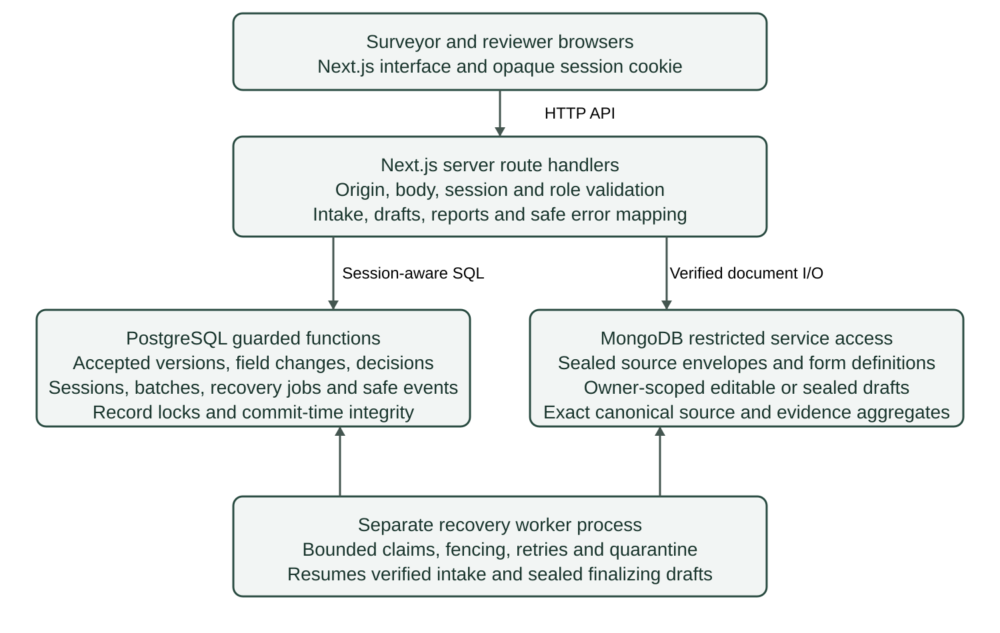

# FieldMerge implemented architecture

Implementation baseline: commit 7588773, migrations 001–010. This explanation describes the existing application; it does not propose a new service stack.

## Browser and authentication boundary

Surveyor and reviewer browser contexts use the same Next.js interface with role-aware navigation. Route handlers authenticate the opaque HttpOnly/SameSite Strict cookie; only its hash is persisted in PostgreSQL. Write handlers require an exact configured Origin. Input is bounded by actual streamed bytes before parsing. Duplicate JSON keys, invalid UTF-8, excessive nesting, unknown canonical fields and invalid scalar precision/types are rejected. The browser never receives database credentials or connects to a database directly.

The API and worker have separate restricted PostgreSQL/MongoDB accounts. API SQL access is through session-aware SECURITY DEFINER functions with fixed search paths, denied direct business-table access, and a non-login publication role the API cannot assume. Authentication bootstrap still trusts the server to verify passwords. No PostgreSQL row-level security is claimed. The authenticated actor determines ownership; client metadata and UUID-shaped identifiers do not grant access.

## Storage ownership

| Store | Owns | Does not establish |
|---|---|---|
| PostgreSQL | Stable tree identities, accepted snapshots, form registry, verified scalar projections, proposal/decision workflow, receipts, sessions, batches, recovery and safe failure events. | That a real observation is biologically correct, or that a matching document exists without verification. |
| MongoDB | Sealed source envelopes, canonical client JSON, repeated evidence, immutable published definitions and owner-scoped drafts. | Accepted truth, SQL referential integrity, or end-user authorization by schema validation alone. |

The shared UUID and canonical fingerprint are logical cross-store references. PostgreSQL cannot create a foreign key into a MongoDB collection. Intake compares authenticated identity, request identity, target/base/form, canonical source and definition hash before trusting the SQL projection. MongoDB retains timestamps as BSON dates and exact diameter as Decimal128; canonical JSON retains source precision/spelling for retry verification.

## Submission flow

1. Validate the envelope and supported form. Reserve the author-scoped request identity in SQL; unchanged retries find its original receipt, changed content conflicts.
2. Insert or verify the same sealed MongoDB source ID. Existing different content cannot be overwritten as a retry.
3. Verify canonical source and registered form, then provide the trusted scalar SQL projection.
4. Lock the tree and read current accepted state and intervening field history. Validate the full item before publication.
5. Publish compatible fields in one SQL transaction. Retain pending proposals separately. Commit snapshots, changes, receipt, live state and business audit together under deferred consistency checks.
6. Return the saved result. Loss of the response does not undo its commit; retry with the same identity and content.

An independent batch contains up to 100 positions, not a distributed or batch-wide transaction. Its manifest and per-item durable outcomes preserve successful items when another item fails. A sealed finalizing draft cannot be edited into different content under the same request identity.

## Review and provenance

The reviewer sees base, latest accepted and proposed typed values. Approval requires the expected accepted version and pending revision, an action, a reason and a reviewer-scoped retry ID. SQL locks and checks these tokens again; stale intent is rejected and requires explicit refresh. A terminal decision is unique per field change. Publication occurs only if the chosen accepted value changes. Carried fields retain their earlier provenance.

## Recovery and failure persistence

The separate foreground worker discovers sealed finalizing drafts and uses persistent SQL jobs with bounded claims, fencing, retry scheduling/backoff and quarantine. No browser session is required and publication remains attributed to its original author. There is no two-phase commit: incomplete SQL/document coordination is visible and recoverable. The worker must be kept running for unattended recovery.

Handled failures receive a new server correlation UUID. Their safe event writes through a separate restricted SQL connection after the original business failure, so rollback cannot erase the event. File fallback has closed fields, append/sync, per-process/day capacity and no overwrite; it excludes request bodies, raw URLs, reasons and credentials. Read access is reviewer-only and bounded. See [security scope and retention limits](FieldMerge_Security.md).

## Evidence and deployment boundary

The design is backed by [35 acceptance cases](FieldMerge_Acceptance.md), representative browser flows, targeted security tests and [local query measurements](FieldMerge_Query_Demonstrations.md). The [catalog and complete dictionary](FieldMerge_Data_Dictionary.md) reconcile the physical implementation. The author-supplied conceptual ER diagram is included on page 9 of the [final PDF report](../output/pdf/FieldMerge_Project_Report.pdf).

Local Docker volumes preserve development data. Test services/databases isolate assertions and deliberate faults. Hosted deployment, supervised worker operations, backup/restore rehearsal, production HTTP headers/TLS and disaster recovery are separate work. Do not infer those guarantees from the local test results.
