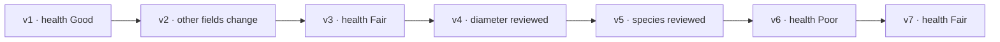

# FieldMerge query demonstrations and viva guide

The runnable catalogue uses FieldMerge's implemented schema and guarded workflow. The [measured results](../output/performance/README.md) include actual query outputs, timings, complete plans, synthetic dataset counts and machine details. This guide explains what to show and why each operation belongs in this project.

## Run the complete demonstration

With Docker Desktop running, dependencies installed, and normal project fixtures prepared:

```powershell
pnpm db:evidence
pnpm db:evidence:summary
```

No Next.js development server or production build is needed for these database-call measurements. The runner creates separate PostgreSQL/MongoDB services in a unique Compose project, applies migrations 001–009 and the existing seed, provisions restricted API credentials, and generates synthetic workflow history. It uses the existing images and Node dependencies. It does not alter development data, .env, production indexes or application migrations. By default, its services and tmpfs data disappear at completion.

The source fixtures have 10,000 imported synthetic trees plus the three standard seed trees. Two thousand receive compatible and conflicting submissions. Both forms, five surveyors, repeated observations, first-intake batches, reviewer decisions, and an evidence-only case are included. Every published nonbaseline version follows the ordinary guarded reconciliation/review path; no trigger or CHECK is disabled to manufacture benchmark volume. Server-generated identities/timestamps and timings vary between runs, while record IDs, logical inputs and workload shape are reproducible.

Inspect these files after running:

| File | What it contains |
|---|---|
| [performance/README.md](../output/performance/README.md) | Human-readable measurements and interpretation |
| [results.json](../output/performance/results.json) | Raw timing samples, SQL/parameters, result samples, comparisons, runtime/settings and data counts |
| [timings.csv](../output/performance/timings.csv) | Compact SQL/Mongo aggregate timing table; an export of measured data, not a spreadsheet model |
| [plans/](../output/performance/plans) | PostgreSQL ANALYZE/BUFFERS plans and MongoDB executionStats |
| [demonstrations.json](../output/performance/demonstrations.json) | Successful CRUD/DDL/workflow checks and independent evidence aggregates |
| [environment.json](../output/performance/environment.json) | Host/Docker resource details, versions, exact image digests and migration checksums |
| [verification.json](../output/performance/verification.json) | Overall pass/failure, unique project/database, retention and cleanup status |

The summary command reads recorded results and writes the Markdown/CSV files; it does not rerun or improve measurements. Run it after each successful measurement run. A failed measurement run is explicitly marked failed; do not present a previous report as evidence for failed or modified code.

## SQL catalogue

The [postgres.sql catalogue](../database/demonstrations/postgres.sql) contains the exact read queries used by the runner. It is a parameterized catalogue, not a psql file to execute whole: queries containing $1 need the record UUID supplied by the Node driver or a PREPARE/EXECUTE statement. Saved results include the actual parameters used.

| ID | Operation to demonstrate | What it answers |
|---|---|---|
| Q01 | JOIN, latest-version view, ORDER BY/LIMIT | What is currently accepted, and which campaign gives it context? |
| Q02 | Pending-review view joined to users | What did this surveyor propose, against which base/current value? |
| Q03 | Filter and ordered history lookup | Which source submissions arrived for this one tree? |
| Q04 | CTE, COUNT, GROUP BY, HAVING | Which trees have multiple pending fields? |
| Q05 | Correlated EXISTS subquery | Which accepted records have an unresolved species proposal? |
| Q06 | Recursive CTE following the parent FK | How does the latest version descend from its immutable baseline? |
| Q07 | Provenance view | Which actual publication/decision introduced each current value? |
| Q08 | Record-scoped CTE and LATERAL origin selection | Can the same provenance result be reconstructed with a narrower intermediate relation? |
| Q09 | Window LAG and IS DISTINCT FROM | Did health actually change between versions, including a later reversal? |
| Q10 | Conditional aggregates | How many fields are explicitly unknown, zero, or false? |
| Q11 | GROUP BY, AVG, sorting | What is the synthetic accepted health distribution and mean diameter? |
| Q12 | Stored validation function | Why is numeric 0 valid while the string "false" is not a boolean? |

Most examples read current relational truth. Q02/Q04/Q05 inspect pending workflow, which must not be counted as accepted values. Q07/Q08 compare equal values, origins and reviewer links, rather than merely comparing row counts.

For Q06/Q09, record `51000000-0000-4000-8000-000000000001` has this real generated lineage:



A proposal prepared at v5 sees Fair in its base and in current v7, but history records Poor at v6. FieldMerge therefore holds a different proposed health value for review. Checking current=base alone would miss that intervening edit. The runner verifies that the stale proposal becomes an intervening_edit conflict and that Q06 reaches v1.

## DDL, DML and MongoDB CRUD

The [sandbox SQL](../database/demonstrations/sandbox-ddl.sql) executes CREATE TEMP TABLE, ALTER TABLE, INSERT, UPDATE, CREATE INDEX, CREATE VIEW, DELETE and explicit DROP. It uses disposable import-staging rows inside a rolled-back transaction. A negative diameter is rejected by a CHECK; a valid zero and false remain known values. Counts of real business rows are unchanged before/after this sandbox. Explain why deleting immutable accepted history would be the wrong way to demonstrate DELETE.

The driver separately exercises real owner-scoped MongoDB draft creation, retrieval, editing with revision checks, and permitted deletion. A second surveyor cannot read that draft. Another draft is finalized through normal intake; its source is retained and a later edit is denied. The runner also demonstrates unchanged submission retry, a revision chain, SQL type validation, and an immutability-trigger rejection. Administrative baseline import and staging operations are distinct from ordinary API permissions.

The [MongoDB query module](../database/demonstrations/mongodb.mjs) provides:

| ID | Query | Database contribution |
|---|---|---|
| M01 | Record filter, projection and receipt/reference sorting | Retrieve source references for review without retrieving every complete envelope |
| M02 | GROUP BY form version, including nested-array sizes | Inspect both retained source-form structures |
| M03 | UNWIND repeated observations, GROUP BY category | Count genuine repeated evidence entries rather than source envelopes |
| M04 | objectToArray and conditional aggregation | Distinguish proposed field presence from explicit null proposals |
| W04 | Application facet aggregate | Compute bounded form/batch/category/presence outputs from stored evidence |

These are evidence queries. SQL supplies accepted records and conflict outcomes. A source envelope can be pending, unverified or quarantined, so source-document counts cannot be relabelled as accepted observations. The five first-intake batches do not count all later transport retries or memberships.

## Advanced concepts to explain

| Concept | Implemented location | Why FieldMerge needs it |
|---|---|---|
| Functions and guarded entry points | reconcile_submission, review_change, api_finish_submission, api_decide | Publish or dispose of a proposal through validated, role-aware operations |
| Transactions and record locks | Reconciliation/review functions | Serialize competing publishers and commit snapshots, field links, receipts and audit together |
| Constraints and deferred triggers | require_initial_version, check_workflow_consistency and parent/source FKs | Reject missing baselines, broken origins, receipt inconsistencies and unlinked publications at transaction completion |
| Immutable-history triggers | block_history_mutation | Deny ordinary UPDATE/DELETE of accepted versions, decisions and audit |
| Uniqueness and idempotency | Author/request and reviewer/decision keys | Retry the same logical action without duplicate effects; reject changed intent under a reused key |
| Views and window/recursive queries | Latest accepted, provenance, Q06 and Q09 | Reconstruct current truth, original value ownership and intervening edits |
| Indexes | Record/receipt, pending-field, parent PK and MongoDB record/time indexes | Restrict selective inspection without treating every aggregate as an index lookup |
| Document validation and aggregation | MongoDB validators, repeated observations, facet pipelines | Retain versioned evidence/drafts with useful typed structure and genuinely repeated data |
| Recoverable cross-store protocol | SQL reservation, sealed Mongo evidence, verification, SQL publication, worker | Recover interruptions without claiming a distributed atomic commit |

The 35-case [acceptance guide](FieldMerge_Acceptance.md) contains deeper race/outage/rollback evidence. This query demonstration does not replace those tests or certify complete security/performance under arbitrary workloads.

## Read the performance evidence carefully

The [measurement report](../output/performance/README.md) separates warmed single-client timings from server execution plans. SQL index A/B removes and restores exactly one existing index only in the disposable database. Every mode switch has an untimed lookup to warm new index pages; both modes must return identical rows. MongoDB uses explicit natural/index hints as controls and also saves the optimizer's unhinted plan. Scan counts and plan changes matter more than a tiny noisy client-time difference.

Nine samples provide a small descriptive comparison, not a statistical confidence interval or a reliable production-tail estimate. EXPLAIN actually executes the query and adds profiling overhead; the report uses TIMING OFF for per-node clocks while retaining total execution/buffer information. Read [PostgreSQL EXPLAIN](https://www.postgresql.org/docs/18/using-explain.html) and [MongoDB executionStats](https://www.mongodb.com/docs/v8.0/reference/explain-results/) alongside the saved plans. No website response-time, concurrent-user capacity or cold-start claim is made.

Q07/Q08's modest provenance timing difference is recorded without promoting a speculative schema/API rewrite. A full-collection aggregate can legitimately scan many rows/documents; a point-lookup index is not evidence that every report should avoid scans. Current evidence supports retaining the existing indexes and measuring a larger/changed workload before further tuning.

## Keep the disposable database for a live viva

```powershell
pnpm run db:evidence --keep
pnpm db:evidence:summary
$bench = Get-Content .\output\performance\verification.json -Raw | ConvertFrom-Json
if ($bench.project -notmatch '^fieldmerge-performance-[a-f0-9]{32}$') { throw 'Unexpected project name' }
$benchOverride = Join-Path (Get-Location) ('tmp/' + $bench.project + '.json')
$benchDocker = Join-Path $env:LOCALAPPDATA 'Programs/DockerDesktop/resources/bin/docker.exe'
& $benchDocker compose -p $bench.project -f .\compose.yaml -f $benchOverride exec postgres-test psql -U fieldmerge_owner -d $bench.database
```

At the psql prompt, use a simple query first:

```sql
SELECT state,count(*) FROM fieldmerge.submissions GROUP BY state ORDER BY state;
```

For parameterized catalogue queries, enter `PREPARE demo(uuid) AS`, paste one SQL query body containing $1, end with its semicolon, then run `EXECUTE demo('51000000-0000-4000-8000-000000000001');`. For Q02 use record ending 000002, which still has pending proposals. Q03's measured record ends 001000. Exit psql with `\q`.

To inspect MongoDB interactively, use the same PowerShell variables and replace the exec tail with `exec mongo-test mongosh --quiet`. Authenticate inside mongosh with `db.getSiblingDB('admin').auth(process.env.MONGO_INITDB_ROOT_USERNAME,process.env.MONGO_INITDB_ROOT_PASSWORD)` and select the database name printed in verification.json. This refers to the container's environment rather than printing its password. Copy aggregation bodies from the query module into `target.submission_documents.aggregate(...)`; that module is imported by the Node runner, not loaded wholesale as a mongosh script.

When finished, remove only that explicit measurement project:

```powershell
& $benchDocker compose -p $bench.project -f .\compose.yaml -f $benchOverride down --timeout 5
```

Do not substitute the ordinary development project or delete its volumes. The default run already cleans its own project automatically; --keep is optional for inspection. If kept data is stopped/removed, its tmpfs contents are not persistent development storage.

## Suggested demonstration order

1. Show dataset counts and the measurement environment.
2. Run Q01 and Q02 to distinguish accepted values from pending proposals.
3. Use Q04/Q05 for workload grouping and an EXISTS subquery.
4. Follow Q06/Q09's reversal and Q07's per-field ownership.
5. Explain Q10's explicit unknown/false/zero counts.
6. Show the SQL and MongoDB index comparisons, including matching result sets and actual plans.
7. Demonstrate staging DDL/DML and owner-scoped drafts; preserve sealed evidence.
8. Explain transaction/trigger protection and cross-store recovery using the saved acceptance evidence.

Final report integration, broader transport/security boundary checks, final ER/schema reconciliation and a clean release rehearsal remain separate checklist items.
